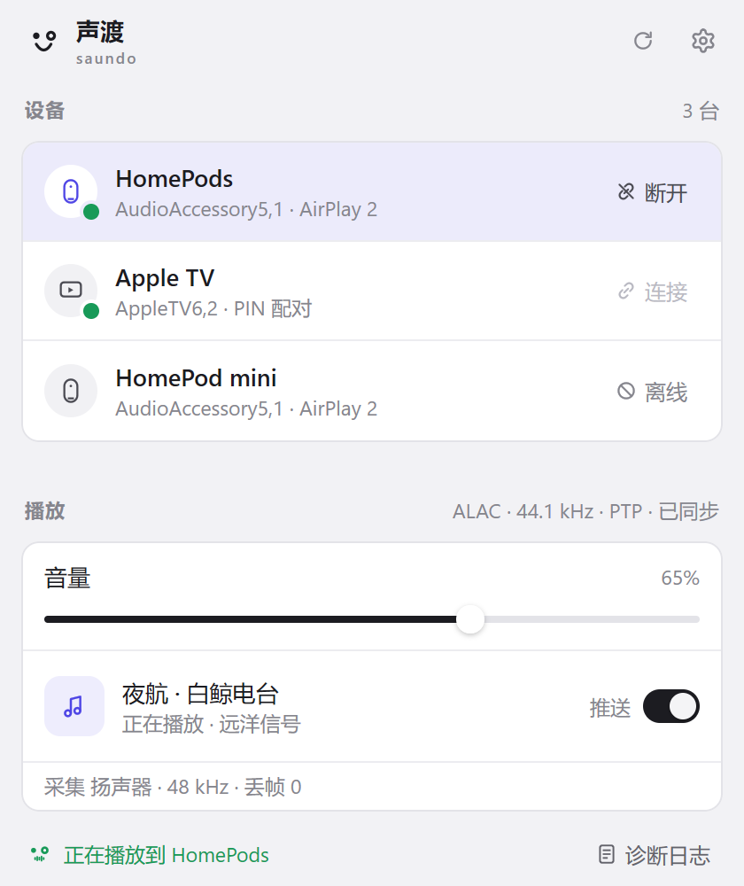
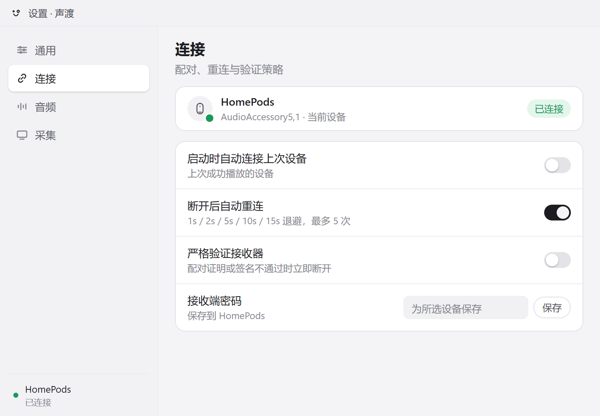

<p align="center">
  
</p>

# saundo · 声渡
声渡 (Shēngdù) — "ferry the sound": 声, sound; 渡, to ferry across. **saundo** is サウンド, the Japanese katakana rendering of "sound".

English · [简体中文](README.zh-CN.md)

### Stream all Windows audio to AirPlay 2 receivers — from the tray, in pure Go.

<p align="center">
  
  &nbsp;&nbsp;&nbsp;
  
</p>

saundo captures whatever Windows is playing — WASAPI loopback, no per-app setup — and streams it as uncompressed ALAC over AirPlay 2 to HomePod, HomePod mini, Mac receivers, and Apple TV. One tray icon, one binary, no WebView. Free software under GPL-3.0-only.

## Is saundo for you?

- You play audio on Windows and want it on a HomePod or a Mac on the same network.
- You want **all** system audio — a browser, a game, a player — not one app's stream.
- You prefer a native tray app over a web view.

Not for you if you need video or screen mirroring (this is audio only), or if your receiver requires Apple FairPlay — some TVs do. saundo detects that class of receiver and fails fast instead of connecting silently.

## Quick start

1. Build it (below) and start `saundo.exe`. The app lives in the tray: a left click opens the panel, a right click opens the menu.
2. Pick a receiver and connect. A receiver that requires a password asks once and remembers it.
3. Play anything on the PC. The sound follows, and the volume slider drives the receiver's own volume.

Windows Firewall prompts on first launch — allow it on private networks: discovery (mDNS) and PTP timing both need inbound UDP.

## What it does

- **System audio capture** — WASAPI loopback of the default output, a fixed endpoint, or a single application.
- **AirPlay 2, properly timed** — uncompressed ALAC at 44.1 kHz, PTP-locked to the receiver's clock (the sender is the PTP master for stereo pairs), encrypted control and event channels, retransmit on request.
- **HomePod stereo pairs** — both members appear as one target and stream in lockstep.
- **Now Playing** — reads the Windows media session (SMTC) and pushes title · artist · album to the receiver, toggleable.
- **English and Simplified Chinese** — the interface follows the Windows language by default, with a language setting and a localized update window.
- **Every pairing class** — password-free transient pairing (HomePod), on-screen PIN (Apple TV), receiver password with a first-connect dialog; credentials are DPAPI-encrypted.
- **Stays out of the way** — suspends the stream after 2 s of digital silence and resumes cleanly, auto-reconnects with backoff, and follows volume changes made on the receiver.

## Install

Requirements: Windows 10 or 11, and Go 1.27+ (the toolchain [mygo](https://github.com/egoist/mygo) needs). No signed downloads yet — build from source:

```bash
make check    # gofmt gate, go vet, mygo UI vet, go test — the acceptance gate
make build    # builds bin/saundo.exe and an NSIS installer (bin/saundo-setup-*.exe) through mygo, then restarts the running app
```

If you just want the app, run the installer `bin/saundo-setup-*.exe` after `make build`.

## Receiver support

| Receiver | Status |
|---|---|
| HomePod / HomePod mini (software 27) | Verified — PTP-timed sessions |
| HomePod stereo pair | Verified — the sender acts as the PTP master |
| Mac, AirPlay Receiver (incl. Require Password) | Verified — password pairing |
| Apple TV, on-screen PIN | Implemented; not yet verified on hardware |
| Receivers that require Apple FairPlay (some TVs) | Not supported — detected at discovery, fails fast |

How each family advertises, pairs, and behaves: [docs/devices.md](docs/devices.md). The failure-mode table (connected-but-silent, pairing 403/470, firewall) and the live-device checklist: [docs/verification.md](docs/verification.md).

## How it fits together

The tray flyout talks to a UI-agnostic engine, which drives a sans-i/o sender state machine over encrypted RTSP. WASAPI loopback feeds a resampler and a ring buffer; a PTP follower (or master, for stereo pairs) keeps every stream on the receiver's clock. Design decisions and risks: [docs/architecture.md](docs/architecture.md). The wire-level protocol: [docs/protocol.md](docs/protocol.md). The code map: [docs/implementation.md](docs/implementation.md).

## Documentation

- [docs/architecture.md](docs/architecture.md) — design decisions, technology choices, risks
- [docs/protocol.md](docs/protocol.md) — the wire-level protocol: pairing, control channel, AP2 session, RTP, timing
- [docs/devices.md](docs/devices.md) — per-receiver profiles: how each family advertises, pairs, and behaves
- [docs/ui.md](docs/ui.md) — the UI design language: tokens, widgets, motion, windows
- [docs/implementation.md](docs/implementation.md) — the code map: runtime model, packages, flows, build
- [docs/verification.md](docs/verification.md) — automated checks, live-test recipes, the evidence log
- [AGENTS.md](AGENTS.md) — operating guide for coding agents

## References

- [airplay2-sender-cpp](https://github.com/akustikrausch/airplay2-sender-cpp) — primary blueprint (Apache-2.0)
- [pyatv](https://github.com/postlund/pyatv) — RAOP transport semantics (MIT)
- [AirFlash](https://github.com/Ding-Kyoma/AirFlash) — WASAPI and PTP code reference, ported under the GPLv3 option
- [magpie](https://github.com/yetone/magpie) — tray flyout and settings design reference

## License

saundo is free software under GPL-3.0-only. See [LICENSE](LICENSE) for the license text and [NOTICE](NOTICE) for third-party attributions.
