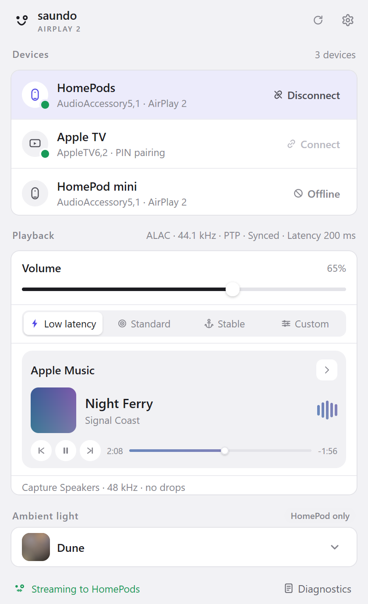
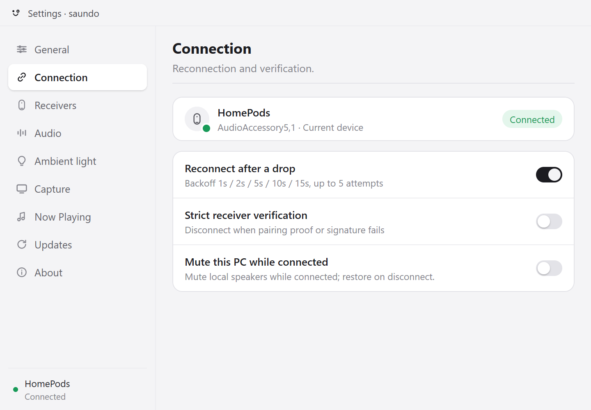

<div align="center">

<a href="https://github.com/4202217/saundo"></a>

# saundo · 声渡

### Stream all Windows audio to AirPlay 2 receivers — from the tray, in pure Go.

**声渡 (Shēngdù) — "ferry the sound": 声, sound; 渡, to ferry across.**<br>
**saundo** is サウンド, the Japanese katakana rendering of "sound".<br>
HomePod, HomePod mini, Mac, and Apple TV: everything the PC plays, one tray click away.

[](https://awesomemygo.dev/apps/saundo) 

**[Download](https://github.com/4202217/saundo/releases/latest)** &nbsp;·&nbsp; **[Issues](https://github.com/4202217/saundo/issues)** &nbsp;·&nbsp; **[Docs](docs/verification.md)** &nbsp;·&nbsp; **English** · [简体中文](README.zh-CN.md)

<br>

<p align="center">
  
  &nbsp;&nbsp;&nbsp;
  
</p>

</div>

<br>

## Is saundo for you?

saundo captures whatever Windows is playing — WASAPI loopback, no per-app setup — and streams it as uncompressed ALAC over AirPlay 2 to HomePod, HomePod mini, Mac receivers, and Apple TV. One tray icon, one binary, no WebView:

- You play audio on Windows and want it on a HomePod or a Mac on the same network.
- You want **all** system audio — a browser, a game, a player — not one app's stream.
- You prefer a native tray app over a web view.

Not for you if you need video or screen mirroring (this is audio only), or if your receiver requires Apple FairPlay — some TVs do. saundo detects that class of receiver and fails fast instead of connecting silently.

Runs on Windows 10 and 11; the interface ships in English and Simplified Chinese and follows the system language by default.

## Quick start

**1 · Install**. Grab the installer from **[Releases](https://github.com/4202217/saundo/releases/latest)**, or build from source:

```bash
mingw32-make check  # gofmt gate, go vet, mygo UI vet, go test — the acceptance gate
mingw32-make build  # builds bin/saundo.exe and an NSIS installer (bin/saundo-setup-*.exe) through mygo, then restarts the running app
```

<sub>The installer is not code-signed yet, so SmartScreen warns. Building from source needs Go 1.27+ (the toolchain [mygo](https://github.com/egoist/mygo) requires) and `mingw32-make` from MinGW-w64; then run `bin/saundo-setup-*.exe`.</sub>

**2 · Connect**. The app lives in the tray: a left click opens the panel, a right click opens the menu. Pick a receiver and connect; one that requires a password asks once and remembers it.

**3 · Play**. Play anything on the PC. The sound follows, and the volume slider drives the receiver's own volume.

<sub>Windows Firewall prompts on first launch — allow it on private networks: discovery (mDNS) and PTP timing both need inbound UDP.</sub>

## What it does

- **System audio capture** — WASAPI loopback of the default output, a fixed endpoint, or a single application.
- **AirPlay 2, properly timed** — uncompressed ALAC at 44.1 kHz, PTP-locked to the receiver's clock (the sender is the PTP master for stereo pairs), encrypted control and event channels, retransmit on request.
- **HomePod stereo pairs** — both members appear as one target and stream in lockstep.
- **Receiver management** — add a receiver by IP or hostname when mDNS cannot find it, keep discovered receivers across power-offs, choose one auto-connect target, hide rows from the panel, and give each receiver a DSP/DAC delay plus its own DPAPI-stored password. A directed unicast pass finds receivers that miss multicast, and both surfaces list only the receivers you can use right now.
- **Now Playing card** — the flyout shows the Windows media session with its cover, title, artist, the transport controls the session reports, and a live five-band meter; switch between open sessions. The Now Playing settings page controls the card, the cover mode, cover colors, the audio level, and the receiver track-info push.
- **Ambient light** — six palettes plus a default reset paint a HomePod's top display through the Now Playing cover. Choose the preset in the Ambient light settings page or the flyout's ambient card.
- **Mute the PC output** — a connection switch mutes the local render endpoint while a session streams and restores it on disconnect, with a guard file that recovers the state after a crash.
- **Appearance** — follow Windows, light, or dark.
- **Latency modes** — low 200 ms, standard 1.5 s, stable 2 s, or a custom 20 to 2000 ms value. Switch in the flyout or the audio page. A live change restarts the stream with a spinner.
- **A tray that shows the state** — the smile, stream, and connect faces animate at 12 frames per 100 ms while connecting or streaming. Turn it off in settings. Reduce Motion holds the static face.
- **Updates in the app** — the settings Update page shows available releases, their notes, and the release history. It installs the signed update. The flyout chip and the tray tooltip point to it.
- **English and Simplified Chinese** — the interface follows the Windows language by default, with a language setting and a localized update page and notes dialog.
- **Every pairing class** — password-free transient pairing (HomePod), on-screen PIN (Apple TV), receiver password with a first-connect dialog; credentials are DPAPI-encrypted.
- **Stays out of the way** — suspends the stream after 2 s of digital silence and resumes cleanly, auto-reconnects with backoff, and follows volume changes made on the receiver.

## Receiver support

| Receiver | Status |
|---|---|
| HomePod / HomePod mini (software 27) | Verified — PTP-timed sessions |
| HomePod stereo pair | Verified — the sender acts as the PTP master |
| Mac, AirPlay Receiver (incl. Require Password) | Verified — password pairing |
| Apple TV, on-screen PIN | Implemented; not yet verified on hardware |
| Receivers that require Apple FairPlay (some TVs) | Not supported — detected at discovery, fails fast |

How each family advertises, pairs, and behaves: [docs/devices.md](docs/devices.md). The failure-mode table (connected-but-silent, pairing 403/470, firewall) and the live-device checklist: [docs/verification.md](docs/verification.md).

## How it fits together

The tray flyout talks to a UI-agnostic engine, which drives a sans-i/o sender state machine over encrypted RTSP. WASAPI loopback feeds a resampler and a ring buffer; a PTP follower (or master, for stereo pairs) keeps every stream on the receiver's clock. Design decisions and risks: [docs/architecture.md](docs/architecture.md). The wire-level protocol: [docs/protocol.md](docs/protocol.md). The code map: [docs/implementation.md](docs/implementation.md).

## Documentation

- [docs/architecture.md](docs/architecture.md) — design decisions, technology choices, risks
- [docs/protocol.md](docs/protocol.md) — the wire-level protocol: pairing, control channel, AP2 session, RTP, timing
- [docs/devices.md](docs/devices.md) — per-receiver profiles: how each family advertises, pairs, and behaves
- [docs/ui.md](docs/ui.md) — the UI design language: tokens, widgets, motion, windows
- [docs/implementation.md](docs/implementation.md) — the code map: runtime model, packages, flows, build
- [docs/verification.md](docs/verification.md) — automated checks, live-test recipes, the evidence log
- [docs/releasing.md](docs/releasing.md) — the release checklist, signing keys, and rollback
- [SECURITY.md](SECURITY.md) — vulnerability reporting
- [AGENTS.md](AGENTS.md) — operating guide for coding agents

## References

- [airplay2-sender-cpp](https://github.com/akustikrausch/airplay2-sender-cpp) — primary blueprint (Apache-2.0)
- [pyatv](https://github.com/postlund/pyatv) — RAOP transport semantics (MIT)
- [AirFlash](https://github.com/Ding-Kyoma/AirFlash) — WASAPI and PTP code reference, ported under the GPLv3 option
- [magpie](https://github.com/yetone/magpie) — tray flyout and settings design reference

## License

saundo is free software under GPL-3.0-only. See [LICENSE](LICENSE) for the license text and [NOTICE](NOTICE) for third-party attributions.
