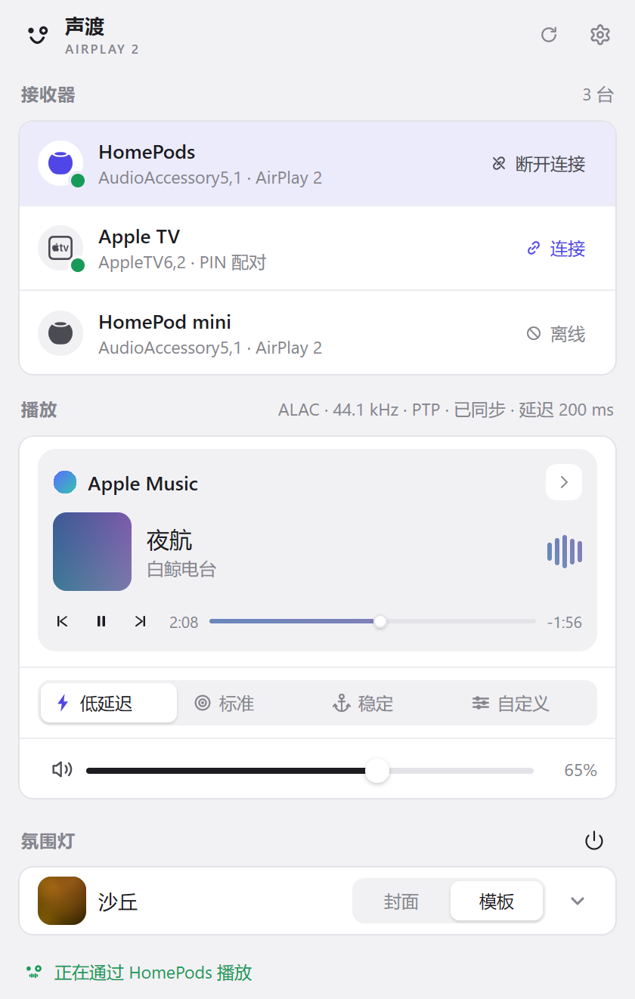
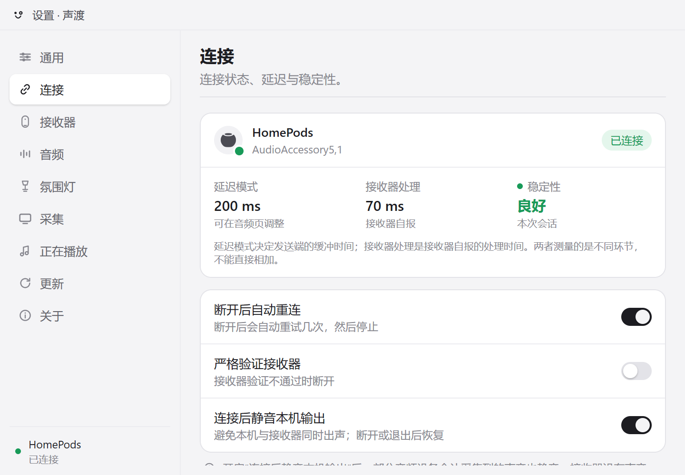

<div align="center">

<a href="https://github.com/4202217/saundo"></a>

# saundo · 声渡

### 把 Windows 的全部系统声音串流到 AirPlay 2 接收端——托盘应用，纯 Go。

**声渡——把声音渡过去：声，声音；渡，摆渡、渡过。**<br>
**saundo** 取自サウンド，英语 sound 的日语片假名转写。<br>
HomePod、HomePod mini、Mac 和 Apple TV，一台电脑的声音，托盘一点就过去。

[](https://awesomemygo.dev/apps/saundo)

**[下载](https://github.com/4202217/saundo/releases/latest)** &nbsp;·&nbsp; **[问题反馈](https://github.com/4202217/saundo/issues)** &nbsp;·&nbsp; **[文档](docs/verification.md)** &nbsp;·&nbsp; [English](README.md) · **简体中文**

<br>

<p align="center">
  
  &nbsp;&nbsp;&nbsp;
  
</p>

</div>

<br>

## saundo 适合你吗？

saundo 采集 Windows 正在播放的一切声音——WASAPI 环回，无需按应用配置——并以未压缩 ALAC 经 AirPlay 2 串流到 HomePod、HomePod mini、Mac 接收端与 Apple TV。一个托盘图标，一个二进制，无 WebView：

- 你在 Windows 上播放音频，想让它出现在同一网络里的 HomePod 或 Mac 上。
- 你要的是**全部**系统声音——浏览器、游戏、播放器——而不是单个应用的串流。
- 你偏好原生托盘应用，而不是 WebView。

如果你需要视频或屏幕镜像（本项目仅音频），或者你的接收端需要 Apple FairPlay——部分电视如此——那它不适合你。saundo 会在发现阶段识别这类设备并快速失败，而不是默默连上却没有声音。

支持 Windows 10 和 11；界面中英双语，默认跟随系统语言。

## 快速开始

**1 · 安装**。从 **[Releases](https://github.com/4202217/saundo/releases/latest)** 下载安装器，或者从源码构建：

```bash
mingw32-make check  # gofmt 门、go vet、mygo UI vet、go test —— 验收门
mingw32-make build  # 经 mygo 构建 bin/saundo.exe 与 NSIS 安装器（bin/saundo-setup-*.exe），随后重启正在运行的应用
```

<sub>安装器尚未代码签名，SmartScreen 会提示。从源码构建需要 Go 1.27+（[mygo](https://github.com/egoist/mygo) 所需的工具链）和 MinGW-w64 的 `mingw32-make`；构建后运行 `bin/saundo-setup-*.exe`。</sub>

**2 · 连接**。启动后应用常驻托盘：左键打开面板，右键打开菜单。选择接收端并连接；需要密码的接收端只询问一次，之后记住。

**3 · 播放**。在电脑上随便播点什么。声音跟过去，音量滑块直接控制接收端自己的音量。

<sub>首次启动 Windows 防火墙会弹窗——请在专用网络上放行：发现（mDNS）和 PTP 时钟同步都需要入站 UDP。</sub>

## 它做什么

- **系统音频采集**——对默认输出、指定端点或单个应用做 WASAPI 环回。
- **时序正确的 AirPlay 2**——44.1 kHz 未压缩 ALAC，PTP 锁定到接收端时钟（立体声组由发送端担任 PTP master），加密的控制与事件通道，按需重传。
- **HomePod 立体声组**——两个成员合并为一个目标，同步起播。
- **接收器管理**——mDNS 发现不到的设备可手动填写 IP 或主机名加入；发现过的接收端断电后仍保留；同时只标记一台自动连接；可把行从面板隐藏；每台接收器可单独设置 DSP/DAC 延迟和经 DPAPI 保存的密码。
- **正在播放**——读取 Windows 媒体会话（SMTC），把 曲目 · 艺人 · 专辑 推给接收端，可开关。
- **延迟模式**——低延迟 200 ms、标准 1.5 s、稳定 2 s，或 20 到 2000 ms 的自定义值。可在 flyout 或音频页切换。直播中切换会重启串流并显示加载状态。
- **托盘状态动画**——连接和串流时，微笑、声波、连接脸以 12 帧、每帧 100 ms 播放。设置里可关闭。Reduce Motion 时保持静态。
- **应用内更新**——设置里的"更新"页显示可用版本、说明和发布历史。它安装签名更新。flyout 的更新提示和托盘 tooltip 指向它。
- **中英双语**——界面默认跟随 Windows 语言，可在设置中切换，更新页和说明弹窗也随语言显示。
- **全类型配对**——HomePod 免密瞬态配对、Apple TV 屏幕配对码、接收端密码（首次连接对话框）；凭据经 DPAPI 加密存储。
- **不打扰**——数字静音 2 秒后挂起串流并干净恢复；断线按退避自动重连；跟随接收端上的音量变化。

## 接收端支持

| 接收端 | 状态 |
|---|---|
| HomePod / HomePod mini（software 27） | 已验证 —— PTP 时序会话 |
| HomePod 立体声组 | 已验证 —— 发送端担任 PTP master |
| Mac（AirPlay 接收器，含"需要密码"） | 已验证 —— 密码配对 |
| Apple TV，屏幕配对码 | 已实现；硬件实测待做 |
| 需要 Apple FairPlay 的接收端（部分电视） | 不支持 —— 发现阶段识别，快速失败 |

每类设备如何广播、配对与表现：[docs/devices.md](docs/devices.md)。失败模式表（已连接但无声、配对 403/470、防火墙）与真机清单：[docs/verification.md](docs/verification.md)。

## 它如何组织

托盘 flyout 与 UI 无关的引擎对话，引擎驱动无 I/O 的发送端状态机，走加密 RTSP。WASAPI 环回喂入重采样器与环形缓冲；PTP follower（立体声组则为 master）让每一路流都锁定接收端时钟。设计决策与风险：[docs/architecture.md](docs/architecture.md)。线级协议：[docs/protocol.md](docs/protocol.md)。代码地图：[docs/implementation.md](docs/implementation.md)。

## 文档

- [docs/architecture.md](docs/architecture.md) —— 设计决策、技术选型、风险
- [docs/protocol.md](docs/protocol.md) —— 线级协议：配对、控制通道、AP2 会话、RTP、时序
- [docs/devices.md](docs/devices.md) —— 每类接收端的档案：如何广播、配对、表现
- [docs/ui.md](docs/ui.md) —— UI 设计语言：令牌、控件、动效、窗口
- [docs/implementation.md](docs/implementation.md) —— 代码地图：运行时模型、包、流程、构建
- [docs/verification.md](docs/verification.md) —— 自动化检查、真机测试配方、证据日志
- [docs/releasing.md](docs/releasing.md) —— 发版清单、签名密钥与回滚
- [SECURITY.md](SECURITY.md) —— 漏洞报告
- [AGENTS.md](AGENTS.md) —— 编码代理的操作指南

## 参考

- [airplay2-sender-cpp](https://github.com/akustikrausch/airplay2-sender-cpp) —— 主要蓝图（Apache-2.0）
- [pyatv](https://github.com/postlund/pyatv) —— RAOP 传输语义（MIT）
- [AirFlash](https://github.com/Ding-Kyoma/AirFlash) —— WASAPI 与 PTP 代码参考，按 GPLv3 选项移植
- [magpie](https://github.com/yetone/magpie) —— 托盘 flyout 与设置窗口设计参考

## 许可证

saundo 是自由软件，采用 GPL-3.0-only。许可证正文见 [LICENSE](LICENSE)，第三方署名见 [NOTICE](NOTICE)。
